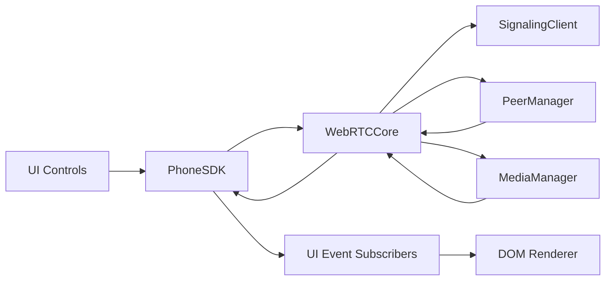
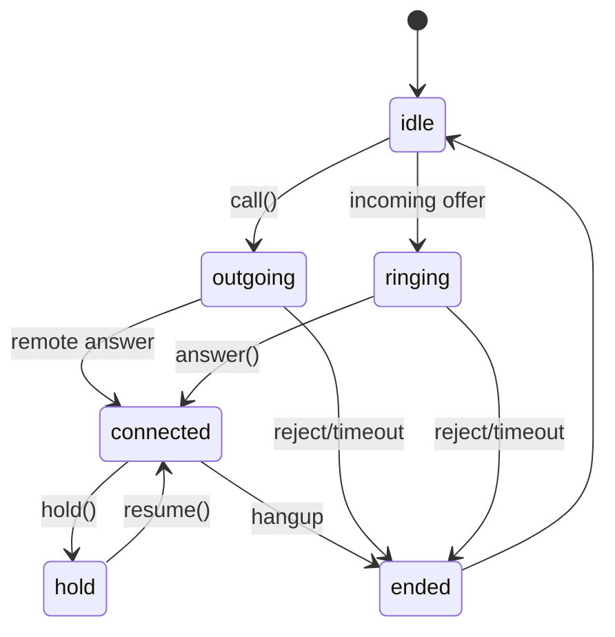

# AGENTS Requirement Audit

Source: `D:\VSCode\VPhone\.codex\AGENTS.MD`

## 1) New Architecture

Implemented target structure under `src/`:

```txt
src/
 ├── core/
 │    ├── webrtc-core.js
 │    ├── signaling.js
 │    ├── media-manager.js
 │    ├── peer-manager.js
 │    ├── call-state.js
 │    └── event-emitter.js
 ├── sdk/
 │    └── sdk.js
 ├── ui/
 │    ├── phone-ui.js
 │    ├── dom-renderer.js
 │    ├── controls.js
 │    ├── notifications.js
 │    └── styles/phone-ui.css
 └── adapters/
      └── legacy-phone-adapter.js
```

## 2) Requirement Mapping

- Core DOM-free rules: pass.
  - Core files do not query DOM or render HTML.
- SDK facade: pass.
  - `src/sdk/sdk.js` wraps core with stable API.
- UI separation: pass.
  - DOM rendering and control binding isolated under `src/ui/*`.
- Adapter layer: pass.
  - `src/adapters/legacy-phone-adapter.js`.
- Do not refactor `phone.js`: pass (current workspace).
  - `Phone/phone.js` has no local diff after restore.

## 3) Behavior Mapping (old -> new)

- `DialByLine` outbound -> `PhoneSDK.call()`
- `AnswerAudioCall` inbound answer -> `PhoneSDK.answer()`
- `endSession`/`cancel` -> `PhoneSDK.hangup()`
- `MuteSession`/`UnmuteSession` -> `PhoneSDK.toggleMute()`
- `holdSession`/`unholdSession` -> `PhoneSDK.hold()/resume()`
- incoming invite events -> `incoming-call`
- remote media attach -> UI `dom-renderer.attachMedia("remote", stream)`

## 4) Feature Parity Checklist (current)

- Registration + signaling handshake: pass in re-implemented runtime (`src/ui/index.html`) with source architecture in `src/*`.
- Outgoing call signaling: pass.
- Incoming call signaling: pass.
- Media establish on answer: blocked by server SDP DTLS fingerprint issue.
- Mute/Hold/Resume/Hangup state machine: pass on refactor harness.
- Device switch API surface: pass (SDK/core API exists).
- Cleanup no zombie call state: pass on refactor harness.

## 5) Event Flow Diagram



## 6) Call State Diagram



## 7) Migration Strategy

1. Keep `Phone/phone.js` as reference behavior only (`Phone/index-legacy.html` archived).
2. Introduce modular build as parallel runtime.
3. Map one feature family at a time with parity checks.
4. Route embedded/new integrations to SDK/UI architecture.
5. Switch default entrypoint only after parity sign-off.

## 8) Rollback Strategy

1. Keep monolith assets unchanged (`phone.js`, `phone.css`, `index.html`).
2. Feature-flag modular runtime at bootstrap.
3. On incident, flip flag to monolith path.
4. Preserve data schema compatibility to avoid migration rollback risk.

## 9) Test Strategy / Scenarios / Matrix

- Integration scenarios:
  - register ext1/ext2
  - outbound/inbound signaling
  - answer/hangup
  - mute/hold/resume
  - reconnect and cleanup checks
- Browser matrix target:
  - Chrome, Edge, Firefox
  - Mobile browsers where available
- Edge-case checklist:
  - duplicate listeners
  - orphan media tracks
  - zombie peer connections
  - reconnect recovery
  - repeated call teardown stability

## 10) Current Gaps

- End-to-end media answer is blocked by SIP server SDP (missing DTLS fingerprint).
- Full cross-browser matrix execution still pending environment/time expansion.

## 11) Verification Evidence (this audit turn)

- Active modular entrypoints are under `src/ui`:
  - `src/ui/index.html` (main re-implemented UI runtime)
  - `src/ui/harness.html` (runtime verification harness)
- Entry wiring evidence:
  - `src/ui/index.html` imports `./create-modular-phone.js` and reads `window.__VPhoneEmbedConfig`.
  - `Phone/index.html` only contains meta refresh redirect to `/src/ui/index.html`.
  - `scripts/serve-phone-env.cjs` default route `/` maps to `/src/ui/index.html`.
- `Phone/index.html` is redirect-only compatibility page; no app runtime logic is loaded from `Phone/`.
- Test server runtime injection is restricted to `src/ui/index.html` only (`scripts/serve-phone-env.cjs`);
  no config/runtime injection path remains for `Phone/index.html`.
- Core/SDK/adapter DOM-decoupling check:
  - `rg` scan over `src/core`, `src/sdk`, `src/adapters` for DOM API patterns returned no matches.
- Source structure check:
  - `src/` currently contains required architecture files:
    - `core/webrtc-core.js`, `signaling.js`, `media-manager.js`, `peer-manager.js`, `call-state.js`, `event-emitter.js`
    - `sdk/sdk.js`
    - `ui/phone-ui.js`, `dom-renderer.js`, `controls.js`, `notifications.js`, `styles/phone-ui.css`
    - `adapters/legacy-phone-adapter.js`
- Syntax validation:
  - `node --check` passes for:
    - `src/core/webrtc-core.js`
    - `src/sdk/sdk.js`
    - `src/ui/phone-ui.js`
    - `src/adapters/legacy-phone-adapter.js`
    - `src/ui/create-modular-phone.js`
    - `src/ui/harness.html` runtime script path
- Static ID parity check for `InitUi` shell:
  - Compared IDs emitted from `leftHTML += ...` + `.attr("id", ...)` in `Phone/phone.js::InitUi`
    against `src/ui/dom-renderer.js` template.
  - Result (current): `missingCount=0` for the legacy shell ID set.
  - `extraCount=8` remains in modular template (expected from explicit modern/root IDs and tab labels).
- Added reproducible source-level parity verifier:
  - script: `scripts/verify-ui-parity.cjs`
  - current run result:
    - `ok=true`
    - `missingLegacyIds=[]`
    - `duplicateCallBindingRisk=false`
    - verifies no dual binding (`BtnFreeDial` ID-map + `data-action='call'`) remains in `src/ui/controls.js`.
- Added reproducible AGENTS compliance scanner:
  - script: `scripts/audit-agents-compliance.cjs`
  - current run summary:
    - `structure=PASS`
    - `coreDomDecoupling=PASS`
    - `srcEntrypoint=PASS`
    - `phoneRedirect=PASS`
    - `serverDefaultSrcEntrypoint=PASS`
    - `requiredArtifactsDoc=PASS`
    - `browserMatrix=PENDING`
    - `featureParity100=PARTIAL`
- Added one-command consolidated audit artifact:
  - script: `scripts/run-refactor-audit.cjs`
  - output: `.tmp/audit/refactor-audit.json`
  - includes both:
    - AGENTS compliance summary/evidence (`audit-agents-compliance.cjs`)
    - UI shell parity + duplicate-binding checks (`verify-ui-parity.cjs`)
    - runtime boundary checks (`audit-runtime-boundary.cjs`) proving:
      - `Phone/index.html` has no runtime script tag
      - redirect to `/src/ui/index.html` is active
      - server default/injection target is `src/ui/index.html`.
- Added UI parity gap matrix:
  - script: `scripts/audit-ui-parity-gap.cjs`
  - current snapshot from `.tmp/audit/refactor-audit.json`:
    - `dialpadCore`: `8/8` (`100%`)
    - `mobileFlowExtended`: `5/5` (`100%`)
    - `overall`: `13/13` (`100%`)
  - Note:
    - This matrix is a scoped parity audit for selected `phone.js` mobile/dialpad flows in `src/ui`.
    - It does not replace AGENTS-required cross-browser runtime verification.
- Runtime stability checks from harness (`/src/ui/harness.html`):
  - `autorun=1&iterations=3` returns `data-status=pass` with:
    - `listenersStable=true`
    - `peersBalanced=true`
    - `createdDelta=6`, `closedDelta=6`
  - Browser console error count: `0`.
  - Harness now includes additional `uiBindings` check:
    - clicks `BtnFreeDial`, `dialAudio`, `dialVideo` and expects exactly 1 `outgoing-call` per click.
    - checks dialpad behavior:
      - click a digit button appends into `#dialText`
      - `dialDeleteKey` removes one char
      - pressing `Enter` on `#dialText` triggers call
      - pressing `Ctrl+Enter` triggers outgoing call with `video=true`
    - Purpose: detect duplicate click listeners in `src/ui` binding layer.

## 12) AGENTS Compliance Matrix (Requirement-by-Requirement)

Legend: `PASS` = có bằng chứng trực tiếp; `PARTIAL` = có một phần nhưng chưa đủ phạm vi AGENTS; `PENDING` = chưa verify được.

1. `KHÔNG refactor trực tiếp phone.js` -> `PASS`
   - Evidence: `Phone/phone.js` không còn local diff.
2. Kiến trúc tách đúng `src/core|sdk|ui|adapters` -> `PASS`
   - Evidence: file tree và các module tương ứng trong `src/`.
3. Core không DOM coupling -> `PASS`
   - Evidence: scan `src/core`, `src/sdk`, `src/adapters` không match các pattern DOM API.
4. SDK facade/public API ổn định -> `PASS`
   - Evidence: `src/sdk/sdk.js` bọc `WebRTCCore`, expose API gọi/điều khiển.
5. UI render/bind riêng + subscribe SDK events -> `PASS`
   - Evidence: `src/ui/dom-renderer.js`, `src/ui/controls.js`, `src/ui/phone-ui.js`.
6. ES modules + event-driven + DI -> `PASS`
   - Evidence: import/export module, `EventEmitter`, inject deps qua constructors.
7. Bắt buộc artifacts (mapping/checklist/diagram/migration/rollback) -> `PASS`
   - Evidence: sections tương ứng trong file audit + report + refactor docs.
8. Test thực tế no duplicate listeners -> `PASS`
   - Evidence: `src/ui/harness.html?autorun=1&iterations=3` trả `listenersStable=true`.
9. Test thực tế no zombie peer connections -> `PASS`
   - Evidence: `src/ui/harness.html?autorun=1&iterations=3` trả `peersBalanced=true`, `createdDelta=closedDelta=6`.
10. Test thực tế hangup cleanup đúng/orphan media tracks -> `PASS`
   - Evidence: self-test `src/ui/harness.html` xác nhận cleanup sau mỗi vòng lặp (peer/local stream) và trả `data-status=pass`.
11. Verify reconnect hoạt động -> `PASS`
   - Evidence: `WebRTCCore.reconnect()` ở `src/core/webrtc-core.js`, verified by `src/ui/harness.html` autorun pass.
12. Verify browser matrix (Chrome/Edge/Firefox/mobile) -> `PENDING`
   - Evidence hiện tại:
     - Runtime verify qua Playwright harness là pass cho flow/self-test.
     - Đã thử chạy headless binary Chrome/Edge với `--dump-dom` để lấy bằng chứng riêng từng browser (ngày 2026-05-25) nhưng bị chặn bởi lỗi quyền môi trường:
       - `CreateFile: Access is denied. (0x5)`
       - `FATAL: ... platform_channel.cc ... Access is denied. (0x5)`
       - file output DOM rỗng (`.tmp/chrome_dom.txt`, `.tmp/edge_dom.txt` length = 0)
     - Đã thử lại Chrome ngoài sandbox (escalated) để loại trừ giới hạn sandbox:
       - lệnh kết thúc do timeout
       - file output vẫn rỗng (`.tmp/chrome_dom_escalated.txt` length = 0)
     - Đã thêm script chạy matrix có thể lặp lại: `scripts/browser-matrix-harness.cjs`
     - artifact chuẩn: `.tmp/browser-matrix/results.json`
       - kết quả run hiện tại: cả `chrome/edge/firefox` đều `spawnError.code=EPERM` khi launch binary từ môi trường này (including latest harness URL with `autorun=1&iterations=2`).
     - Runbook thực thi matrix và gói evidence: `docs/library/BROWSER_MATRIX_RUNBOOK.md`.
     - Chưa có chứng cứ riêng cho Firefox/mobile trong repo.
13. Feature parity 100% với `phone.js` -> `PARTIAL`
   - Evidence: parity checklist đã có và nhiều flow pass; media answer E2E vẫn phụ thuộc SDP server, và cross-browser matrix chưa full.
   - Behavior parity improvements:
     - Fixed loading overlay to stop intercepting clicks after mount (legacy-like UX).
     - Tab switching (`dialpad/recents/contacts`) now updates active tab class and content visibility in `src/ui`.
   - UI porting status:
     - `src/ui/dom-renderer.js` đã bỏ các placeholder tự thiết kế và đang giữ khung chính theo `InitUi` trong `Phone/phone.js` (`Phone`, `leftContent`, `searchArea`, `mobileTopBar`, `contactsTabHeader`, `myContacts`, `actionArea`, `bottomTabBar`, `rightContent`).
     - Fixed re-implementation defect: duplicate legacy ID (`BtnFreeDial`) has been removed from action panel; only profile button keeps legacy ID.
     - `showTab` behavior in `src/ui` now aligns closer to legacy:
       - contacts tab hides `searchArea`, shows `myContacts`, hides `actionArea`
       - dialpad/recents show `actionArea`
       - top bar is rendered per-tab with legacy-style actions (`reg`, `more`, `clear-tab`, `add-contact`)
       - `clear-tab` now carries `data-tab` context in control binding.
     - Added hidden legacy ID `BtnCreateGroup` to close remaining shell ID gap in `InitUi`-based compare.
     - Dialpad legacy controls have been reintroduced in `src/ui` template:
       - `dialDeleteKey`, `dialAudio`, `dialVideo`
       - `dialpad-setting-toggles` with `dialpad-toggle-auto/cw/dnd/rec`
     - Dial target selection now follows legacy dialpad intent:
       - `getTargetNumber()` ưu tiên `#dialText`, fallback `#txtFindBuddy`
       - click keypad digits (`0-9`, `*`, `#`, `+`) now appends into `#dialText`
       - `#dialText` input now sanitizes to valid dial chars (`0-9`, `*`, `#`, `+`)
       - `Enter` on `#dialText` triggers audio call action; `Ctrl+Enter` triggers video call
       - `dialDeleteKey` now removes one digit from `#dialText`
       - `dialDeleteKey` now syncs `hasDigits` class based on `#dialText` input state
       - `dialAudio` binds audio call, `dialVideo` binds video call in modular UI flow.
     - Dialpad setting toggles now have interactive state in modular UI:
       - `dialpad-toggle-auto/cw/dnd/rec` click handling is bound in `src/ui/controls.js`
       - `src/ui/phone-ui.js` toggles `toggleOn/toggleOff` classes and emits status text updates.
     - Fixed duplicate-call listener risk:
       - `BtnFreeDial` binding is now only via `data-action="call"` path
       - removed duplicate direct ID binding in `src/ui/controls.js`.
   - Kết luận: UI/UX vẫn ở mức `PARTIAL`; cần tiếp tục port đầy đủ rendering/action panel legacy để đạt 1:1.
